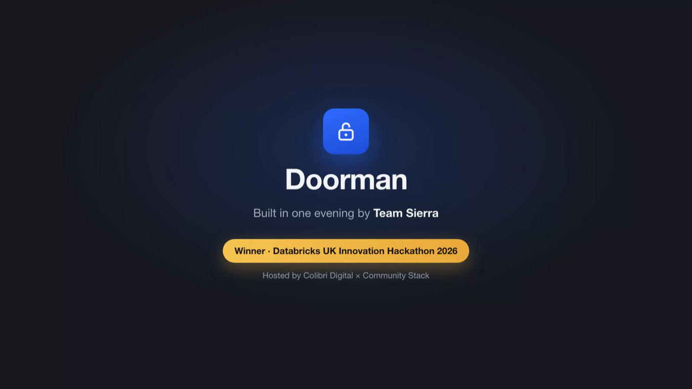
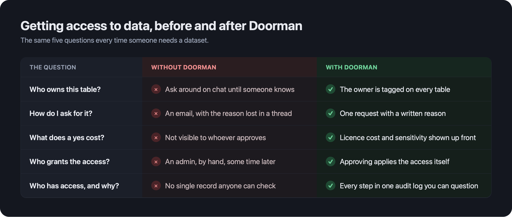
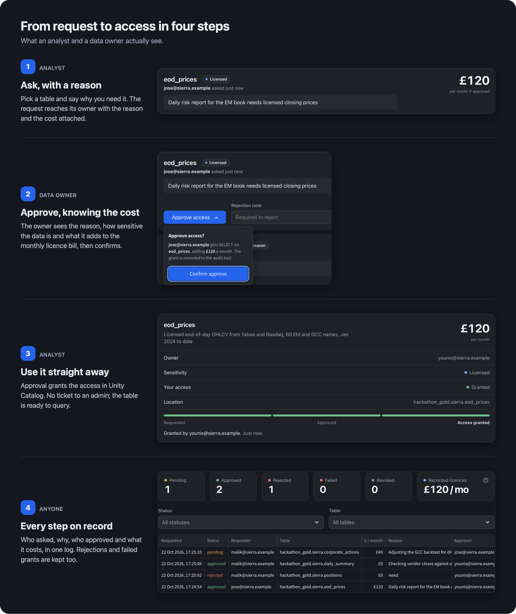
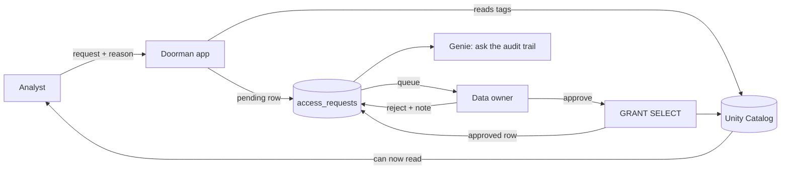

<p align="center">
  
</p>

<p align="center">
  <b>Self-service data access on Databricks, governed by default.</b><br>
  An analyst asks for a table. Its owner approves. The approval is a real Unity Catalog <code>GRANT</code>, and every step is audited.
</p>

<p align="center">
  <a href="https://github.com/younis-y/doorman-databricks/releases/tag/demo-video">Demo video (84 s)</a> ·
  <a href="#run-it-locally">Run it locally</a> ·
  <a href="#how-it-works">How it works</a>
</p>

---

On a trading desk, getting access to a dataset usually means an email to someone who may or may not own it, a grant done by hand, and no record of why. Doorman replaces that with one app: request with a reason, see the licence cost, approve or reject, and keep the receipt.

Built in one evening by Team Sierra at the **Databricks UK Innovation Hackathon** (Colibri Digital x Community Stack, London, 21 Oct 2026), Track 3: *The Governed Front Door*. It won.

<p align="center">
  
</p>

## Four steps, two people

<p align="center">
  
</p>

## How it works



Three rules make it governed by default:

1. **The catalogue is the tags.** A table appears in the app only if it carries a `data_owner` tag in Unity Catalog. Tag a table and it is requestable; no code change. The `sensitivity` and `licence_cost_gbp` tags tell the approver what a yes costs.
2. **Only the tagged owner decides**, and the decision is a real `GRANT SELECT`, or a rejection with a note the requester sees. The app never keeps a permission flag of its own.
3. **One table is both the queue and the receipt.** Pending rows in `access_requests` are the approval queue; all rows are the audit trail. A failed grant is recorded with its error, never hidden.

The app runs SQL as the signed-in user (the Databricks Apps `sql` user scope), so a person's rights in the app are exactly their rights in Unity Catalog. Each reason is also scored by `ai_classify` so owners see a **Vague reason** flag before they approve.

## The pages

| Page | What you see |
|---|---|
| **Catalogue** | Every tagged table with its owner, sensitivity and £/month. Request access with a reason and follow your own requests. |
| **Approvals** | Requests waiting on you, with the reason, the cost and the vague-reason flag. Approve, reject with a note, or revoke access you granted earlier. |
| **Audit** | Every request ever made, filterable, with headline counts and "Ask the audit trail", a Genie space over two audit views. |

## Run it locally

No Databricks account needed. The hackathon workspace was shut down on 22 Oct 2026, so this is the way to try it now.

```bash
git clone https://github.com/younis-y/doorman-databricks.git
cd doorman-databricks
pip install streamlit pandas
./run-local.sh            # http://localhost:8501
```

Data comes from a SQLite file built on first run from `local/*.csv`, with the same products and tags as `sql/`. Approvals are simulated in the browser session, and an **Act as** switch in the sidebar lets one laptop play both analyst and owner. The Genie box is hidden off-platform.

## Run it on Databricks

Against your own workspace, where grants are real:

```bash
pip install streamlit "databricks-sdk>=0.60" pandas
databricks auth login --host https://<your-workspace>.cloud.databricks.com --profile <profile>
GOVERNANCE=live DEV_USER=you@example.com DATABRICKS_CONFIG_PROFILE=<profile> \
DATABRICKS_WAREHOUSE_ID=<warehouse-id> streamlit run app.py
```

Run `sql/setup.sql` once first to create the tagged tables and `access_requests`. To deploy as a Databricks App, `app.yaml` holds the start command and environment.

| Variable | Default | Purpose |
|---|---|---|
| `GOVERNANCE` | `stub` when `DEV_USER` is set, else `live` | `live` applies real grants; `stub` simulates everything in memory |
| `DATA_CATALOG`, `DATA_SCHEMA` | `hackathon_gold`, `sierra` | Where the tagged tables and `access_requests` live |
| `DATABRICKS_WAREHOUSE_ID` | none | SQL warehouse for the Statement Execution API |
| `GENIE_SPACE_ID` | empty (box hidden) | Enables "Ask the audit trail" |
| `LOCAL_DB` | unset | Path to a SQLite file; runs the same queries offline |

## Tests

```bash
python3 -m pytest -q tests     # 40 tests, offline, SQL mocked
```

## Project layout

| Path | Role |
|---|---|
| `app.py` | The Streamlit app. Three pages; it only reads, and every change goes through `governance` |
| `governance.py` | `submit_request`, `approve`, `reject`, `revoke`: the only code that grants |
| `governance_stub.py` | The in-memory stand-in used locally and in tests |
| `db.py` | One `run_sql` over the Statement Execution API, as the signed-in user when a token is forwarded |
| `sql/` | Setup, demo catalogue, the two Genie views, and a reset script for rehearsals |
| `local/` | CSVs and the builder for the offline SQLite copy |
| `AGENTS.md`, `docs/` | The briefs the team built against, a front-end review, and the pitch deck |

## Not built yet

Expiring access, notifications outside the app, column masks, and running as the app's own service principal (the sandbox would not grant it catalog or warehouse rights, so the user-scope route was used instead).

## Team Sierra

**Younis Younis** built the back end: governance, grants, data model and platform. **Jose** and **Malik** built the front end. **Patrick** tested it and built the test datasets. Built with Claude Code and Codex.
