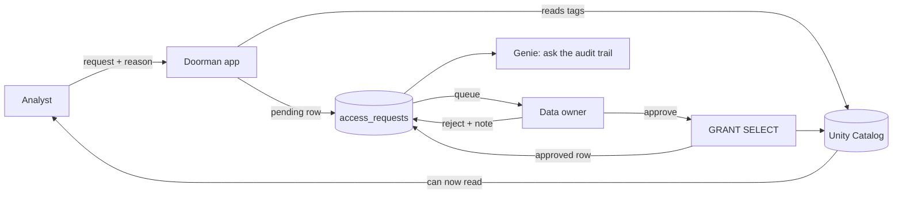

# Doorman

The doorman for market data on a trading desk, built as a Databricks App. (Internally the
project is still `desk-data-access`.) An
analyst asks for a table and gives a reason. The table's owner sees the reason and the
monthly licence cost, then approves or rejects. Approval applies a **real Unity Catalog
grant**. Every step lands in one audit table that Genie can answer questions about.

Built in one evening for the Colibri Digital hackathon (21 Oct 2026), Track 3: *The
Governed Front Door*.

## How it works



Three rules make it governed by default:

1. **The catalogue is the tags.** A table is requestable only if it carries a `data_owner`
   tag in Unity Catalog. Tag a table and it appears in the app; no code change. The same
   tags carry `sensitivity` and `licence_cost_gbp`, so the approver sees what a yes costs.
2. **Only the tagged owner can decide**, and the decision is a real `GRANT SELECT` (or a
   rejection with a note the requester sees). The app never flips a flag of its own.
3. **One table is both the queue and the receipt.** `access_requests` holds every request;
   pending rows are the approval queue, all rows are the audit trail. A failed grant is
   recorded with its error, never hidden.

The app runs SQL as the signed-in user (Databricks Apps `sql` user scope), so a person's
rights in the app are exactly their rights in Unity Catalog.

## The pages

| Page | What you see |
|---|---|
| **Catalogue** | Every tagged table with owner, sensitivity and £/month; request access with a reason; your own requests and their state |
| **Approvals** | Requests waiting on you, with the reason, the cost and a "vague reason" flag from `ai_classify`; approve, reject, or revoke access you granted earlier |
| **Audit** | Every request ever made, filterable; headline counts; "Ask the audit trail" through a Genie space with three tested questions |

## Run it

Deployed: `desk-data-access` in the hackathon workspace. On first open, accept the consent
screen for the `sql` scope.

Locally (runs as you, grants are real):

```bash
pip install streamlit "databricks-sdk>=0.60" pandas
databricks auth login --host https://dbc-ea0a1678-b98c.cloud.databricks.com --profile hack
GOVERNANCE=live DEV_USER=you@example.com DATABRICKS_CONFIG_PROFILE=hack \
DATABRICKS_WAREHOUSE_ID=a24300104bf8ac6c streamlit run app.py
```

Without `GOVERNANCE=live` the app uses `governance_stub.py`, which simulates everything in
memory and touches nothing in Unity Catalog. The sidebar "Act as" switch (local only) lets
one laptop play analyst and owner.

Tests (offline, SQL mocked):

```bash
python3 -m pytest -q tests
```

## Layout

| File | Role |
|---|---|
| `app.py` | The Streamlit app: three pages, reads only, every change goes through `governance` |
| `governance.py` | `submit_request`, `approve`, `reject`, `revoke`: the only code that grants |
| `db.py` | One `run_sql` over the Statement Execution API, as the signed-in user when a token is forwarded |
| `sql/setup.sql` | Data products, tags and the `access_requests` table (ran once) |
| `sql/genie_views.sql` | The two views the Genie space is allowed to see |
| `sql/reset_demo.sql` | Revoke and clear one requester's rows between rehearsals |
| `AGENTS.md`, `BACKEND.md` | The briefs the two halves of the team built against |
| `UI_REVIEW.md` | Review of the front end with a follow-up list |

## What it does not do yet

Expiring access, notifications outside the app, column masks, running as the app's own
identity (the sandbox would not grant it catalog or warehouse rights, so the user-scope
route was used instead).

## Team

Jose and Malik (front end), Younis and Patrick (data, governance, platform). Built with
Codex and Claude Code.
