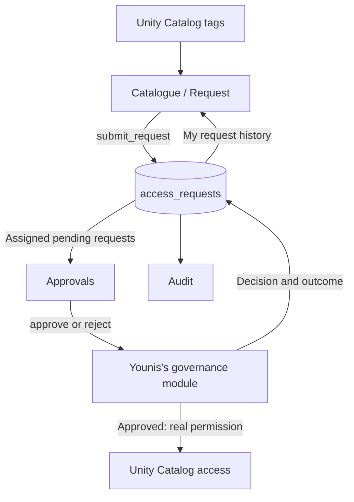

# Desk Data Access — UI Plan for Team Sierra

## Focus and ownership

Build the three-page Streamlit interface described in [AGENTS.md](AGENTS.md),
targeting **`hackathon_gold.sierra`**.

We own the screens, read queries, configuration, local stub, and demo presentation.
Younis owns the governance functions, database setup, and real grants. Deployment
and platform permissions stay with the backend team as described in
[docs/BACKEND.md](docs/BACKEND.md). This plan includes their latest UI handoff.

## Existing tools we will reuse

| Tool | How it supports our UI |
| --- | --- |
| **Unity Catalog tags** | Populate asset names, descriptions, owners, sensitivity, and monthly costs automatically. Adding another tagged table updates the catalogue without changing UI code. [Reference](https://docs.databricks.com/aws/en/sql/language-manual/information-schema/table_tags) |
| **Databricks Apps authentication** | Supply the signed-in email and user token through forwarded headers. [Reference](https://docs.databricks.com/aws/en/dev-tools/databricks-apps/auth) |
| **Databricks Apps configuration** | Supply the warehouse ID through `app.yaml`. The backend team obtains warehouse access for the app identity; our account cannot attach the warehouse as a resource because it lacks MANAGE. [Reference](https://docs.databricks.com/aws/en/dev-tools/databricks-apps/app-runtime) |
| **Streamlit interactive tables** | Provide sorting, scrolling, column formatting, and single-row selection for the catalogue. [Reference](https://docs.streamlit.io/develop/api-reference/data/st.dataframe) |
| **Streamlit forms and navigation** | Provide the three pages, reason fields, explicit submission actions, and validation feedback. [Forms](https://docs.streamlit.io/develop/api-reference/execution-flow/st.form), [navigation](https://docs.streamlit.io/develop/api-reference/navigation/st.navigation) |

Use these existing capabilities within the app. The conditional Genie UI below
consumes a space configured by the backend team; creating platform services is
outside our UI work.

## Screens and visual design

Use Apple Design principles for hierarchy, alignment, accessibility, and clear
feedback. The appearance is a dark trading-desk interface: solid navy/slate
surfaces, thin separators, restrained blue actions, readable system typography,
and **no gradients**.

Keep the title and signed-in email visible across all three pages. Use native
Streamlit controls and the agreed table-and-details layout.

### Catalogue / Request

- A selectable table showing asset, description, owner, sensitivity, and **£/month**.
- Selected asset details and a required reason field underneath.
- **Request access** submits once and displays confirmation or an inline error.
- The user's request history follows, including rejection and failure notes.
- Discover assets from their tags; never hard-code product table names in the UI.

### Approvals

- Only pending requests assigned to the current user.
- Show requester, asset, reason, age, and prominent monthly licence cost.
- **Approve access** and **Reject request**, with a required rejection note.
- Refresh after a decision and retain its success or failure message.
- Show an amber **Vague reason** badge when a pending request's `note` is `vague`,
  using the classification already supplied by governance.

### Audit

- Complete request records, newest first, filtered by status and table.
- Headline pending, approved, and rejected counts.
- Monthly licence value calculated from approved requests, with wording that
  identifies it as recorded approvals rather than verified billing.
- Include failed requests and all decision details.

After AC-001–AC-007 pass, add **Ask the audit trail** only when `GENIE_SPACE_ID`
is configured. Use the SDK calls specified in AGENTS.md, render the query result
as a dataframe with its description, and show a clear message if no query result
is available. Include a free-text question field and the three preset questions
from [docs/BACKEND.md, section 4](docs/BACKEND.md#4-genie-space-1815-to-1845-in-the-ui-sidebar--genie-agents):

- Who has access to positions right now?
- What is our total licence spend per month, by table?
- Which requests are still pending and how old are they?

The backend team owns the Genie space, views, permissions, and validation of these
questions. Only validated presets are used during the live demo.

Use text alongside status colours, visible keyboard focus, and clear loading,
empty, and error states. Preserve entered reasons after errors. The proposed
column-preview addition is outside the initial UI scope.

## Integration contract

Preserve the schema and function signatures from AGENTS.md:

```python
governance.submit_request(requester, table_name, reason)
governance.approve(request_id, decided_by, user_token)
governance.reject(request_id, decided_by, note)
db.run_sql(statement, params=None)
```

- App queries are read-only; all changes go through governance.
- Use `WorkspaceClient`, named SQL parameters, and `DATABRICKS_WAREHOUSE_ID`.
- Configure `DATABRICKS_WAREHOUSE_ID` as the plain environment value
  `a24300104bf8ac6c`, following the updated backend handoff. Do not use the earlier
  `valueFrom: sql-warehouse` configuration.
- Use the updated helper behaviour: a 50-second statement wait and an empty list
  for successful statements with no result schema.
- Catalogue membership comes from the `data_owner` tag. Display `description`,
  `sensitivity`, and `licence_cost_gbp` alongside it.
- Cast licence-cost values returned by SQL before performing calculations.
- Preserve all request fields and the `pending`, `approved`, `rejected`, and
  `failed` statuses.
- Use `X-Forwarded-Email` for the deployed identity and pass
  `X-Forwarded-Access-Token` to approval when available. Missing identity disables
  request and decision actions.
- Production requirements remain `databricks-sdk` only, as agreed in AGENTS.md.

For isolated local development, use `governance_stub.py` with the same signatures
and a persistent **Local simulation — no access permissions changed** label.
The stub stores requests in `st.session_state` and writes nothing to Databricks.
Local identity switching requires `DEV_USER`, shares the same session's request
history, and is unavailable in deployment. All three pages read that same stub
history during simulation.



## Build and verification

1. Build the shared visual shell and Catalogue against the stub.
2. Complete Approvals and Audit using the same stub records.
3. Connect live reads and integrate Younis's governance module.
4. Verify AC-001–AC-008 in AGENTS.md, then polish and rehearse.

Test blank reasons, duplicate requests, correct approver filtering, rejection
notes, failed approvals, complete audit records, and one governance call per
action. Verify that another tagged asset appears after refresh without a UI code
change. Check the vague-reason badge and that the Genie box is hidden without its
configuration. Use Streamlit AppTest plus browser checks for keyboard navigation
and layout.

The backend team handles deployment and the real denied-before/allowed-after demonstration.
The demo requester must be outside `hackathon_sierra` and have the required
catalog/schema usage permissions while initially lacking table access.

Do not build a query-as-user box: the current forwarded token cannot run SQL.
Use the SQL editor for the denied-before/allowed-after demonstration, as specified
in docs/BACKEND.md. Notifications, access expiry, column masks, Lakebase, additional
pages, and a second app remain outside this UI delivery.
